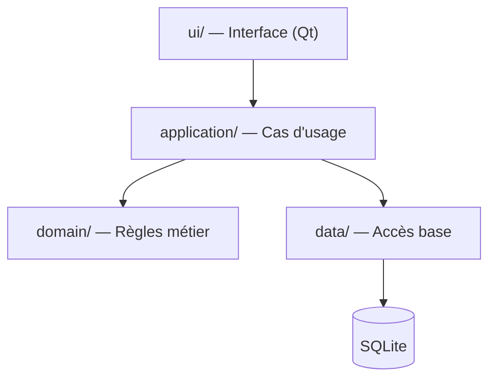

# Comprendre le projet Caisse

Ce document explique **pourquoi** le projet est construit tel qu'il est : chaque technologie, chaque dossier, chaque règle a une raison précise. Le but n'est pas seulement d'obtenir un programme qui fonctionne, mais de comprendre chaque décision — c'est la méthode de travail convenue.

---

## 1. Le projet en une phrase

> Construire une application de caisse (encaisser des ventes, gérer des produits, enregistrer l'historique) **en C++17 avec Qt pour l'interface et SQLite pour les données**, de manière progressive et pédagogique.

« Progressive » veut dire : on part d'un squelette qui compile, et on n'ajoute chaque brique **qu'au moment où elle devient utile**. Pourquoi cette méthode ?

- **Chaque nouveauté arrive avec un problème à résoudre**, donc on comprend sa raison d'être au lieu de l'accepter par magie.
- **Le projet compile à tout instant** : si quelque chose casse, on sait exactement quel ajout en est la cause.
- On évite le piège classique du débutant : se lancer dans l'interface graphique avant d'avoir un modèle métier solide, puis tout réécrire.

---

## 2. Pourquoi ces trois technologies ?

### Pourquoi C++ ?

- **Performance et contrôle** : une caisse traite des montants et doit être fiable et rapide. C++ n'impose aucune structure cachée — on comprend ce que fait la machine.
- **C'est le langage de ton cours de POO** : le projet sert de terrain d'application concrète (classes, encapsulation, composition, séparation des responsabilités).
- **C++17** est la version retenue : moderne (structures liées, `std::optional`, `string_view`…), et c'est le minimum demandé par Qt 6.

### Pourquoi Qt ?

- Écrire une interface graphique « à la main » (avec l'API Windows ou X11) demanderait des milliers de lignes pour une seule fenêtre. Qt fournit des composants prêts à l'emploi : boutons, tables, champs de saisie.
- Qt est **multiplateforme** : le même code compile sous Windows, Linux, macOS.
- Qt apporte des mécanismes propres au C++ : les **signaux et slots** (communication entre objets), et des outils intégrés (QDate, QString…).
- Qt propose en plus un **module SQL** — ce qui pose justement une décision à prendre (voir § 8).

### Pourquoi SQLite ?

- Une caisse a besoin de **persistance** : les produits, les ventes et l'historique doivent survivre à l'arrêt du programme.
- SQLite est une base **embarquée** : c'est une bibliothèque qui lit/écrit un simple fichier — pas de serveur à installer ni à administrer. Parfait pour une application de bureau.
- Elle est **transactionnelle** : on peut garantir qu'une vente est enregistrée en entier (ligne de vente + total + stock) ou pas du tout. C'est crucial quand on manipule de l'argent.

---

## 3. Pourquoi CMake, et pas juste « g++ main.cpp » ?

Un programme d'un seul fichier se compile avec une commande. Mais un projet réel a des dizaines de fichiers qui **dépendent les uns des autres**, et des bibliothèques externes (Qt, SQLite). CMake résout trois problèmes :

1. **Automatiser la compilation** : CMake décrit le projet une fois (`CMakeLists.txt`), puis génère les vrais fichiers de build (Makefile, Ninja…). Chaque fichier recompilé uniquement s'il a changé.
2. **Trouver et lier les bibliothèques** : `find_package(Qt6 ...)` retrouve automatiquement où Qt est installé sur ta machine, quel que soit l'ordinateur.
3. **Reproductibilité** : n'importe qui (y compris toi sur une autre machine) récupère le dossier, lance les mêmes deux commandes, et obtient le même binaire.

Ligne par ligne, notre `CMakeLists.txt` actuel :

```cmake
cmake_minimum_required(VERSION 3.16)
```
> Garde-fou : refuse les CMake trop anciens qui ne comprendraient pas la syntaxe suivante. Chaque projet CMake commence par cette ligne.

```cmake
project(caisse VERSION 0.1.0 ... LANGUAGES CXX)
```
> Déclare le nom du projet, sa version, et surtout la **langue** (CXX = C++), pour que CMake active les règles de compilation C++.

```cmake
set(CMAKE_CXX_STANDARD 17)
set(CMAKE_CXX_STANDARD_REQUIRED ON)
set(CMAKE_CXX_EXTENSIONS OFF)
```
> Trois lignes qui disent : « compile en C++17, refuse d'accepter autre chose, et sans les extensions propriétaires de GCC ». Sans `REQUIRED`, un compilateur trop vieux baserait silencieusement sur un standard plus ancien — et ton code moderne échouerait à la compilation sans raison claire.

```cmake
add_executable(caisse app/main.cpp)
target_include_directories(caisse PRIVATE ${CMAKE_CURRENT_SOURCE_DIR}/include)
```
> Déclare l'exécutable et ses sources ; la seconde ligne indique où chercher les `#include` (le dossier `include/` qui accueillera nos en-têtes).

**La compilation en deux commandes** (`cmake -B build -S .` puis `cmake --build build`) : la première **configure** (CMake analyse le projet, vérifie le compilateur, génère les fichiers de build dans `build/`), la seconde **construit** (invoque le compilateur). Le dossier `build/` est jetable et ignoré par Git — on peut le supprimer et tout reconstruire à l'identique.

---

## 4. Comment C++ compile — et pourquoi `include/` et `src/` sont séparés

C'est le mécanisme le plus important à comprendre pour la suite :

1. **Chaque `.cpp` est compilé séparément** en un fichier objet (`.o`).
2. Pour compiler un `.cpp`, le compilateur doit connaître les **déclarations** des classes/fonctions qu'il utilise : elles vivent dans les **en-têtes** (`.hpp`), « collés » par le préprocesseur via `#include`.
3. L'**éditeur de liens** assemble tous les `.o` en un seul programme.

D'où la convention du projet :

- **`include/caisse/`** : les en-têtes = le *contrat* public (« voici ce que la classe `Money` propose »). C'est la partie qu'on montre aux autres fichiers.
- **`src/`** : les implémentations = *comment* le contrat est tenu. Détail interne, modifiable sans toucher au contrat.

Séparer les deux clarifie qui peut dépendre de quoi, évite de recompiler tout le projet à chaque petit changement d'implémentation, et c'est la convention classique des bibliothèques C++. La règle « `.hpp`/`.cpp` partout sans mélanger » (héritée du cours de POO) garantit simplement l'homogénéité : mélanger `.h`, `.hpp`, `.cc` n'apporte rien et rend le projet confus.

---

## 5. Pourquoi une architecture en couches ?

La structure cible n'est pas décorative : chaque dossier porte une **responsabilité unique**.



- **`domain/`** (Product, Sale, SaleItem, Money) : le cœur. Règles pures : « un panier ne peut pas être vide au moment de payer », « un prix est un entier en centimes ». **Aucune dépendance** à Qt, à SQLite ou à l'interface. C'est du C++ pur — donc testable sans base de données ni fenêtre.
- **`application/`** (CheckoutService, ProductService) : les cas d'usage. « Encaisser un panier » = orchestrer les objets du domaine, charger les produits, demander l'enregistrement. C'est le chef d'orchestre.
- **`data/`** (Database, ProductRepository, SaleRepository) : la seule couche qui connaît SQL. Le reste du code ne sait pas d'où viennent les données.
- **`ui/`** (MainWindow) : affichage et saisie. La fenêtre ne *calcule* rien ; elle présente et transmet les événements.

**Ce que cette séparation apporte concrètement :**

- **Testabilité** : `Money` et `Sale` se testent sans base ni écran.
- **Remplaçabilité** : si on change d'avis (SQLite direct → Qt SQL, ou même PostgreSQL), seul `data/` change.
- **Lisibilité** : pour savoir où chercher une erreur, chaque question a une adresse : « c'est une règle métier ? → domain. Un écran ? → ui. Du SQL ? → data. »
- **La règle des flèches** : les dépendances pointent vers le domaine, jamais l'inverse. Le domaine ne sait pas qu'une interface existe. C'est ce qu'on appelle une architecture « hexagonale » ou « en oignon », version simplifiée.

---

## 6. Pourquoi les montants en centimes entiers ?

La règle la plus importante du projet : **jamais de `double` ni `float` pour l'argent.**

Les nombres flottants utilisent la norme IEEE 754, en base 2. Or `0,10` (dix centimes) **n'existe pas exactement en base 2**, exactement comme ⅓ n'existe pas exactement en décimal (0,3333…). Essaie : en C++, `0.1 + 0.2` donne `0.30000000000000004`, pas `0.3`.

```cpp
double total = 0.0;
for (int i = 0; i < 10; ++i) total += 0.10;   // 0.9999999999999999, pas 1.0 !
```

Pour des données scientifiques, cette imprécision est acceptable. Pour une caisse, elle est **intenable** : totaux faux, arrondis incohérents, écarts à l'inventaire. Les vrais systèmes bancaires et les caisses professionnelles stockent donc des **entiers en unités minimales** (centimes) :

- `1250` = 12,50 F CFA/francs — selon la devise, la plus petite unité réelle
- Addition, comparaison, TVA : opérations **exactes** sur des entiers.
- L'affichage « 12,50 » est un simple problème de **formatage**, résolu uniquement au moment d'afficher.

C'est pour cela que `Money` existera dans `domain/` : une petite classe qui encapsule un `long long` en centimes, refuse les valeurs invalides, et formate proprement pour l'affichage.

---

## 7. Pourquoi des tests, et pourquoi si tôt ?

Un test est un **programme qui vérifie le programme** : il appelle un code avec une entrée connue et compare avec le résultat attendu. Exemple futur : `Money(100) + Money(250)` doit donner `Money(350)` — pas 349,99999.

Pourquoi en faire dès le début plutôt qu'à la fin ?

- **À la fin, tester devient un chantier** : personne ne veut écrire 200 tests d'un coup. Au fil du code, chaque test coûte 5 minutes.
- **Les tests sont un filet de sécurité** : quand on modifiera le code (et on le modifiera), relancer les tests confirme qu'on n'a rien cassé ailleurs — c'est ça, une régression.
- **Tester oblige à écrire du code testable** : pour tester `Money`, il faut qu'elle ne dépende ni de Qt ni de la base. Les tests *poussent* vers la bonne architecture du § 5.
- Deux niveaux prévus, à ne pas confondre :
  - **`tests/unit/`** : une classe, une règle, en isolation (`tst_Money`, `tst_Sale`). Rapides, exécutés à chaque compilation.
  - **`tests/integration/`** : plusieurs briques ensemble, avec une vraie base SQLite temporaire (`tst_Database`, `tst_SaleRepository`) : vérifie que le SQL fait bien ce que le domaine attend.

On commencera par `tst_Money` car c'est la classe la plus petite et la plus critique du projet : si les montants sont faux, tout le reste l'est.

---

## 8. Les décisions encore ouvertes (et comment on les prendra)

### SQLite direct ou Qt SQL ?

C'est **le** choix à faire avant l'étape « couche d'accès aux données ». En résumé :

- **API SQLite directe** (`sqlite3_*`) : on voit tout, on apprend vraiment SQL et le fonctionnement de la base ; aucun intermédiaire. Contrepartie : plus de code à écrire, plus de responsabilité (ouverture, transactions, messages d'erreur).
- **Module Qt SQL** (`QSqlDatabase`, `QSqlQuery`) : s'intègre naturellement avec Qt, plus concis, gère les types Qt automatiquement. Contrepartie : une couche d'abstraction qui masque ce qui se passe réellement.

Le projet étant pédagogique, l'argument « voir ce qui se passe » pèse lourd — mais on fera une comparaison complète, avantages/inconvénients, avant de trancher.

### Le cahier des charges d'abord

Avant de figer le modèle de données (tables, colonnes), on écrira `docs/cahier-des-charges.md` : quelles fonctions la caisse doit-elle offrir ? (vente, rendu de monnaie, remises, gestion de stock, annulation de vente, rapports journaliers…). **Chaque table doit correspondre à un besoin réel** — sinon on invente des colonnes qu'on ne saura pas remplir. C'est le sens de l'étape 3 du plan.

---

## 9. Les fichiers « outils » : pourquoi ils existent

| Fichier | Rôle | Pourquoi il compte |
|---|---|---|
| `.gitignore` | Liste ce que Git doit ignorer | `build/` et la base locale sont **générés** ; les versionner polluerait le dépôt et créerait de faux conflits |
| `.clang-format` | Règles de mise en forme automatique | Le formatage devient non-négociable : plus de débat de style, des diffs Git propres |
| `.clang-tidy` | Analyse statique du code | Détecte des bugs avant l'exécution : variables non initialisées, fuites, casts suspects |
| `CMakePresets.json` | Configurations prêtes à l'emploi | « Debug / Release / tests » en une commande, identique pour tous |
| `docs/` | Cahier des charges, architecture, décisions | Écrire une décision la rend traceable ; dans 3 mois, on saura *pourquoi* on a choisi Qt SQL ou pas |
| `.gitkeep` | Fichier invisible dans un dossier vide | Git ne suit que les fichiers ; c'est le moyen standard de versionner un dossier encore vide |
| `db/migrations/` | Évolution du schéma dans le temps | Une base installée chez un utilisateur doit pouvoir évoluer sans tout perdre |

Ces fichiers ont été classés « à faire » (et non plus « facultatifs ») à ta demande : ils seront ajoutés **au moment utile** — par exemple `.clang-format` quand le premier fichier source apparaîtra vraiment, pas avant.

---

## 10. Le plan, et pourquoi dans cet ordre

| # | Étape | Pourquoi *maintenant* et pas plus tard |
|---|---|---|
| 1 | Arborescence + squelette | Un contenant minimal qui **compile** : base saine, vérifiable |
| 2 | CMake + programme minimal | Apprivoiser la chaîne de compilation **avant** d'y ajouter Qt |
| 3 | Qt + première fenêtre | L'interface peut maintenant s'appuyer sur un build qui marche |
| 4 | Schéma SQLite + choix d'accès | Le cahier des charges est prêt → le modèle découle des besoins |
| 5 | Métier : produits, montants, panier, ventes | Cœur du projet ; `Money` en centimes d'abord, tout le reste s'appuie dessus |
| 6 | Persistance fiable : transactions, erreurs | Maintenant qu'on écrit vraiment en base, garantir l'intégrité |
| 7 | Tests | Menés en parallèle de 5–6, ils verrouillent chaque brique |

**Où on en est** : étapes 1–2 réalisées côté fichiers (squelette créé) ; il reste à compiler en local pour valider l'étape 2. Prochain rendez-vous : Qt et la première fenêtre.

---

## 📌 À retenir en cinq points

1. **Progressif et expliqué** : chaque brique arrive avec le problème qu'elle résout.
2. **Couches** : métier (`domain`) au centre, interface et base en périphérie, dépendances vers l'intérieur.
3. **Argent = entiers en centimes**, jamais de flottants.
4. **CMake** parce qu'un projet multi-fichiers + bibliothèques ne se compile pas à la main.
5. **Tests au fil de l'eau** : filet de sécurité et gage de bonne architecture.